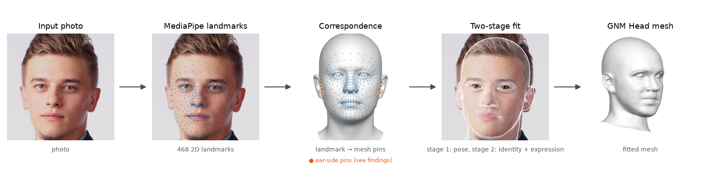
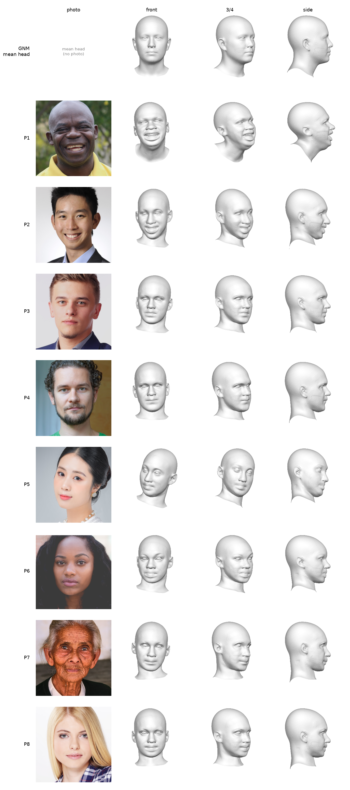

# GNM Avatar

Fit Google's [GNM Head](https://github.com/google/gnm) 3D model (identity, expression, pose)
to a single face photo, using the 468 MediaPipe face landmarks and a PyTorch optimiser.



## Key findings

Measured on 8 portraits (P1–P8). Details and all tables: [docs/RESULTS.md](docs/RESULTS.md).

- **Correspondence:** the v2 file fixes the eyes but moves the points next to the ears (93/323, 234/454) 16–19 mm onto the ear; v2-nowarp (the default) fixes the ears but not the eyes. [More](docs/RESULTS.md#correspondence-versions)
- **Expression clamping:** about 37% of expression parameters (132–156 of 383) end at ±3 on every photo, including faces with little visible expression such as P3 and P6. [More](docs/RESULTS.md#correspondence-versions)
- **Identity:** fitted identities vary as much as GNM's own samples, but the head parameters are far off the prior (L2 20.5 vs 12.9), which suggests overfitting to landmarks. [More](docs/RESULTS.md#identity-check)
- **Not measured:** identity accuracy; there are no ground-truth 3D scans. [More](docs/RESULTS.md#identity-check)

Next step: add normal cues from Meta's Sapiens to constrain depth around the mouth and eyes. See [docs/RESULTS.md#future-work](docs/RESULTS.md#future-work).

<p align="center">
  <a href="results/v2-nowarp/summary_grid_3d.png">
    
  </a>
</p>

Input photos from Pixabay (Pixabay Content License); sources in [data/SOURCES.md](data/SOURCES.md).

## Quick start

Needs Python 3.13, the GNM code and weights, and the MediaPipe model:
see [docs/SETUP.md](docs/SETUP.md).

```bash
git clone https://github.com/google/GNM.git gnm
git -C gnm checkout 3ec07cb                             # tested GNM commit
pip install -r requirements.txt
pip install -e "gnm/gnm/shape[pytorch]"
python src/fit_gnm.py --image <your_photo>.jpg          # → data/gnm_fit.obj, .npz, overlays
python src/fit_gnm.py --image <your_photo>.jpg --view   # same, plus a 3D viewer
```

Flags, outputs, the other scripts and the batch evaluation: [docs/SETUP.md](docs/SETUP.md#usage).

## Limitations

- Many identity and expression parameters saturate at ±3. This may indicate that the
  landmark-only fit does not separate identity from expression well.
- Orthographic camera (scale + 2D offset): close-up selfies and strong head turns fit worse.
- Fits 2D landmarks only, so depth (nose length, face depth) is weakly constrained.
- Geometry only: no texture, colour, hair or appearance.
- One face per image, one image per run, CPU only.
- Outputs use fixed file names and are overwritten on each run (use `--out-dir`).

Full list with numbers: [docs/RESULTS.md](docs/RESULTS.md#limitations-in-detail).

## Privacy

Photos, fitted meshes and per-photo results are git-ignored. The only published
images of people are the two figures above: Pixabay face crops (P1–P8; P3 in the
pipeline figure), which exist only inside those PNGs. Details: [docs/SETUP.md](docs/SETUP.md#privacy-details).

## License

Code in this repository: Apache 2.0 (see [LICENSE](LICENSE)). Third-party files keep
their own license and attribution: the correspondence files and
`src/gnm_mediapipe_landmarks.py` (pundirmr's gist, Apache 2.0). GNM Head and
MediaPipe are not included and have their own licenses.

## Credits

- [GNM Head](https://github.com/google/GNM), Google, Apache 2.0.
- [MediaPipe Face Landmarker](https://ai.google.dev/edge/mediapipe/solutions/vision/face_landmarker), Google, Apache 2.0.
- The correspondence files and `src/gnm_mediapipe_landmarks.py` come from
  [MediaPipe 468-landmark correspondence for GNM Head](https://gist.github.com/pundirmr/ecf0c0bb5c93fc1a9534083a8b6d255e)
  by pundirmr (community-built, unofficial). It is derived from GNM and MediaPipe's
  canonical face model and released under Apache 2.0.
  - `data/head_dense_468_v2.txt` is v2, gist revision
    [`48b295d`](https://gist.github.com/pundirmr/ecf0c0bb5c93fc1a9534083a8b6d255e/48b295d0d8f0ec60740263a8c3adc395d7859fed)
    (2026-10-27), SHA-256 `553b1a334db0cb7a69e8c9f4799ad4743242853679b4be051308766df18dbe8b`.
  - `data/head_dense_468_v2_nowarp.txt` (the default) was built locally with the same
    revision's builder, without the warp. See [Building v2-nowarp](docs/RESULTS.md#building-v2-nowarp).
  - `src/gnm_mediapipe_landmarks.py` is from the first revision (`01bd756`, 2026-07-31).

This project is not affiliated with Google.

If you use GNM Head, cite:

> S. Ploumpis et al., "GNM Head: A Generative aNthropometric Model of the human head",
> arXiv:2607.23687, 2026.

```bibtex
@article{ploumpis2026gnmhead,
  title={GNM Head: A Generative aNthropometric Model of the human head},
  author={Ploumpis, S. and Bednarik, J. and Zoss, G. and Guseinov, R. and Prasso, L. and Chandran, P. and Boyne, O. and Choutas, V. and Bolkart, T. and Wang, D. and Chai, M. and Qiu, D. and Winberg, S. and Rainer, G. and Bridgeman, L. and Vicini, D. and Riviere, J. and Boetzel, Y. and Koumis, A. and Busch, J. and Herrera, C. and Still, J. and Ysebert, S. and Lincoln, P. and Escolano, S. O. and Rhemann, C. and Wood, E. and Beeler, T. and Zafeiriou, S.},
  year={2026},
  eprint={2607.23687},
  archivePrefix={arXiv},
  url={https://arxiv.org/abs/2607.23687},
}
```
