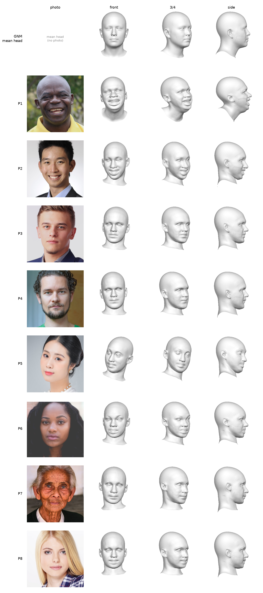

# Results

All numbers below were measured on 8 Pixabay portraits, labelled P1–P8. The photos
are not included in this repository. Full tables: [`results/metrics.md`](../results/metrics.md)
and [`results/metrics.csv`](../results/metrics.csv).

**Landmark residual** = 2D distance between a MediaPipe landmark and the projected
GNM point, divided by the inter-ocular distance (MediaPipe points 33–263),
averaged over the region's landmarks. It measures only 2D agreement with
MediaPipe, not 3D accuracy.

## Method

- Single photo, one face → fitted GNM Head mesh (`.obj`) and parameters (`.npz`).
- Dense 468-point MediaPipe → GNM correspondence (`data/head_dense_468_v2_nowarp.txt`,
  see [Correspondence versions](#correspondence-versions)).
  Each landmark is a barycentric point on the GNM mesh (3 vertex indices + weights),
  so it stays valid for any identity, expression and pose.
- Two-stage optimisation (Adam, CPU):
  1. camera scale/offset + joint rotations (1500 steps),
  2. identity + expression + rotations + camera (1500 steps), with small L2
     regularisation on identity, expression and rotations.
- Region-weighted smooth-L1 landmark loss: eyes ×5, nose and mouth ×2, the rest ×1.
- Diagnostic outputs: per-region landmark error statistics, a landmark error image,
  a mesh-over-photo overlay, and an optional interactive 3D viewer (`--view`).

## Landmark residual (v2-nowarp, the default)

| Region | Mean | Range over 8 photos |
| --- | --- | --- |
| All 468 landmarks | 0.0078 | 0.0064–0.0092 |
| Right eye | 0.0145 | 0.0122–0.0164 |
| Left eye | 0.0157 | 0.0126–0.0214 |
| Nose | 0.0049 | 0.0035–0.0072 |
| Mouth | 0.0040 | 0.0030–0.0057 |
| Face contour | 0.0044 | 0.0034–0.0074 |

- Mean error 6.3 px (3.4–10.3 px) on photos 1500–6000 px wide.
- Mouth and face contour fit best. The eyes fit worst, although they have 5× weight in the loss.
- Fit time 36.3 s per photo (34.8–38.4 s) for the two optimisation stages, on CPU.

## Correspondence versions

Three MediaPipe → GNM correspondence files were compared, with the same fitting code:

- **v1**: gist revision `01bd756`.
- **v2**: gist revision `48b295d`. It adds a thin-plate warp that pins 68 MediaPipe points
  to GNM's 68 sparse landmarks.
- **v2-nowarp**: the v2 builder run without the warp. Built locally, see
  [Building v2-nowarp](#building-v2-nowarp).

Mean over the 8 photos:

| Landmark residual | v1 | v2 | v2-nowarp |
| --- | --- | --- | --- |
| All 468 landmarks | 0.0100 | 0.0069 | 0.0078 |
| Right eye | 0.0175 | 0.0031 | 0.0145 |
| Left eye | 0.0140 | 0.0034 | 0.0157 |
| Nose | 0.0045 | 0.0100 | 0.0049 |
| Mouth | 0.0081 | 0.0063 | 0.0040 |
| Face contour | 0.0046 | 0.0113 | 0.0044 |
| Point 93 (subject's right) | 0.0057 | 0.0533 | 0.0066 |
| Point 323 (subject's left) | 0.0041 | 0.0474 | 0.0034 |
| Point 234 (subject's right) | 0.0061 | 0.0076 | 0.0039 |
| Point 454 (subject's left) | 0.0034 | 0.0106 | 0.0019 |
| Identity parameters at ±3 (of 253) | 23.8 | 28.2 | 16.6 |
| Expression parameters at ±3 (of 383) | 158.6 | 148.9 | 141.8 |

- **v2 fixes the eyes** (residual 0.0031 / 0.0034, against 0.0175 / 0.0140 for v1).
- **v2 breaks the points next to the ears.** v2's 68-point table pins MediaPipe points
  93/323 and 234/454 (the face outline next to the ears) to GNM jaw landmarks.
  On the GNM template, v2 places these points about 19 mm (93/323) and 16 mm
  (234/454) lower and further back than v1, onto the ear. Their residual is
  9–12× higher than v1 at 93/323, and the nose and contour residuals more than double.
- **v2-nowarp keeps the ears and contour right** and has the lowest mouth,
  contour and ear-point residuals, and the fewest parameters at ±3. Its eyes are
  back at v1 level, because the warp was what fixed the eyes.
- v2-nowarp is the default. A mixed file is listed under [Future work](#future-work).

## Building v2-nowarp

`data/head_dense_468_v2_nowarp.txt` (the default) was built with
`build_mediapipe_correspondence.py` from gist revision `48b295d`, GNM commit `3ec07cb`,
and `canonical_face_model.obj` from [google-ai-edge/mediapipe](https://github.com/google-ai-edge/mediapipe)
(`mediapipe/modules/face_geometry/data/`, SHA-256
`8bac80443397e113f41a8b565ea72c59390bc031d9defab289dba7bc0c54e618`):

```bash
python build_mediapipe_correspondence.py --canonical canonical_face_model.obj \
    --no-warp --no-gnm75-fix --out data/head_dense_468_v2_nowarp.txt
```

Output SHA-256: `34bf5d47d9a35fd8bd59a13554305cf2aea11b5010f4f3a539d402995dfbd7ab`.

- `--no-warp` skips the 68-point thin-plate warp.
- `--no-gnm75-fix` is needed with GNM `3ec07cb`. GNM already contains the fix
  for its issue #75 (jaw landmark order), so the builder's own fix would reverse
  the order a second time. With `--no-gnm75-fix` and the warp on, the builder
  reproduces the published v2 file exactly.
- **Known issue:** the builder flags v2-nowarp as `COLLAPSED`. Its check
  measures the vertical inner-lip opening (points 13 to 14) on the neutral GNM
  template, gets 1.31 mm and expects more than 2 mm. The 3D distance between
  the same points is 3.31 mm, which passes the self-check in
  `src/gnm_mediapipe_landmarks.py`. Both eye openings pass (8.77 / 8.83 mm).

## Identity check

Each fitted identity is rebuilt with expression = 0 and pose = 0 and compared with
the GNM mean head (identity = 0). Distance = mean per-vertex distance, over all
17,821 vertices, or over the 4,592 face vertices. The face vertices are GNM's
`hockey_mask` vertex group: outer face skin, without eyes, teeth, ears, neck or
back of head.

There are two baselines, each with 200 random identities and the same method:
- GNM's own sampler, `semantic_sampler.IdentitySampler().randomize_identities()`:
  a conditional VAE with random gender and ethnicity weights.
- N(0, 1) per value, clipped to ±3 like the fit.

| Set | L2 norm | L2 head (170) | L2 teeth (80) | To mean head, all / face (mm) | Pairwise, all / face (mm) |
| --- | --- | --- | --- | --- | --- |
| 8 fits (v2-nowarp) | 21.03 | 20.49 | 3.97 | 3.46 / 3.46 | 2.78 / 2.75 |
| 200 × GNM IdentitySampler | 15.88 | 12.94 | 7.63 | 3.18 / 2.25 | 3.55 / 2.77 |
| 200 × N(0, 1), clipped | 15.87 | 12.99 | 8.94 | 5.23 / 3.96 | 7.38 / 5.59 |

- **How GNM scales identity values.** GNM's README gives a typical range of
  −3 to +3. The identity basis vectors shrink with index: on average, a unit
  value moves a vertex 3.47 mm for the first head component and 0.02 mm for the
  last. GNM's sampler gives a mean L2 norm of 15.88, close to √253 ≈ 15.9.
  Together this is consistent with unit-variance components. The GNM code does
  not state it explicitly.
- **The fitted shapes vary about as much as GNM's own sampled identities.** On the
  face region, the fits differ from each other by 2.75 mm, against 2.77 mm for the
  sampler. They are not closer to the mean head than sampled identities: 3.46 mm,
  against 2.25 mm for the sampler.
- **The head parameters are far off the prior.** The head L2 norm is 20.49, against
  12.94 for the sampler. Each fit has 8–24 head values at ±3, against 0 for
  the sampler. This suggests the fit overfits to landmark detail. The 3 eye
  identity values stay at 0.00 in every fit.
- **Identity accuracy is not measured.** Per-vertex distance to the mean head or
  between fits cannot say whether a fit looks like the person. That needs
  ground-truth 3D scans, which this test set does not have.

## 3D renders



Input photos from Pixabay (Pixabay Content License); sources in [data/SOURCES.md](../data/SOURCES.md).

Columns: face crop of the input photo, then the fitted mesh from the front, at 45°
and at 90°. The first row is the GNM mean head, then P1–P8. The 8 rings of faces
next to the open neck edge are not drawn.

## Future work

These are plans. None of them is built or tested.

- **Normal cues from [Sapiens](https://github.com/facebookresearch/sapiens)** (Meta's
  human-centric vision model, which predicts surface normals from a photo). The fit
  uses only 2D landmarks, so depth is weakly constrained, most of all around the
  mouth and eyes. Planned steps:
  1. A sparse normal-agreement term: at each of the 468 pins, compare the mesh
     normal with the Sapiens normal at the pin's projected pixel, and add the
     difference to the loss.
  2. Later, a dense version: render the mesh normals with a differentiable
     rasterizer and compare them with the Sapiens normal map over the whole face.
  3. Compare this with a stronger identity prior alone, to see which one reduces
     the parameter saturation.
  4. Evaluate on ground-truth scans (for example NoW), not only on 2D landmarks.

  Before using Sapiens, check its license and whether it allows this use.
- A mixed correspondence file: v2 rows for the eyes, v2-nowarp rows elsewhere.
  Not built or tested.
- Evaluate on a benchmark with ground-truth scans (for example NoW), to measure
  identity accuracy instead of 2D landmark agreement.

## Reproduce with your own photos

```bash
python src/batch_fit.py --images <your_photo_folder>   # fits, metrics.md / .csv
python src/identity_check.py --version v2-nowarp        # identity section of metrics.md
python src/render_3d.py --version v2-nowarp             # results/v2-nowarp/summary_grid_3d.png
```

`batch_fit.py` fits every photo with all three correspondence files. It needs
`data/head_dense_468_v1.txt`, which is not in this repository. Download it from
gist revision `01bd756`.

## Limitations in detail

- **Many identity and expression parameters saturate at the bounds** (±3).
  On 8 test portraits, a mean of 16.6 of 253 identity parameters (range 8–24, about 7%)
  and 141.8 of 383 expression parameters (range 132–156, about 37%) end at ±3.
  All clamped identity parameters are in the head part (16.6 of 170, about 10%).
  This may indicate that the landmark-only fit does not separate identity from
  expression well.
  The bounds and regularisation are unchanged; this is measured, not yet fixed.
- **Eyes fit worse with the default correspondence.** v2-nowarp has a 4–5× larger
  eye landmark residual than v2. v2 fits the eyes better but misplaces the points
  next to the ears.
  See [Correspondence versions](#correspondence-versions).
- **Orthographic camera** (scale + 2D offset). No perspective, so close-up
  selfies and strong head turns fit worse.
- Fits **2D landmarks only**. Depth (nose length, face depth) is weakly constrained
  by a single view.
- **Geometry only**: no texture, colour, hair or appearance.
- One face per image, one image per run. No video or multi-photo fitting.
- CPU only (`DEVICE = "cpu"`).
- Outputs use fixed file names and are overwritten on each run (use `--out-dir`
  to keep runs apart).
- Evaluation measures only 2D agreement with the MediaPipe landmarks. There is
  no ground-truth 3D comparison, so a low error does not prove a correct 3D shape.
